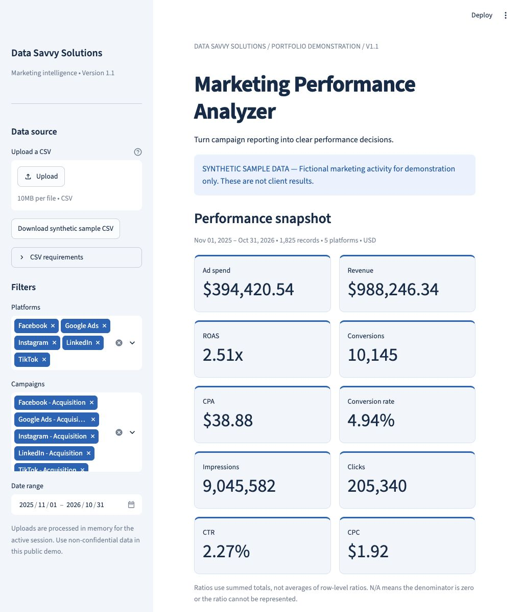
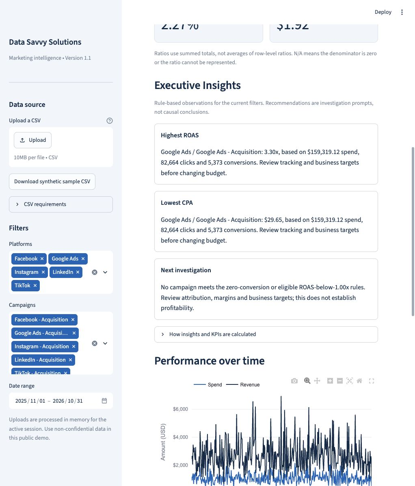

# Data Savvy Solutions | Marketing Performance Analyzer V1.2

A Streamlit portfolio demonstration that turns campaign activity into a performance snapshot, explainable executive insights, trends, and channel comparisons. The navy, blue, and white interface uses native controls, responsive KPI cards, and consistent USD/percentage/ratio formatting.

**The built-in dataset is synthetic. It does not represent client results or evidence of business impact.** The fixed seed generates 1,825 fictional daily records across five platforms, from November 1, 2025 through October 31, 2026.

After the results, **Work With Data Savvy Solutions** connects visitors to the [business contact page](https://datasavvysolutions.net/contact/) to discuss custom reporting and marketing analytics. It uses a native Streamlit link button and leaves V1.2 calculations, CSV handling, and insights unchanged. The contact invitation is tested with synthetic and uploaded data. Merging to the branch used by Streamlit Cloud may automatically redeploy the app; obtain owner approval before merging.

## Version 1.2 presentation

Executive Insights explain reported revenue per ad dollar and ad cost per recorded conversion, with cautious next steps. They distinguish revenue from profit and do not claim ads caused sales. A sole eligible campaign is not presented as a comparison; exact ties use a disclosed alphabetical example, and leading values that look equal after rounding are flagged.

Cards, filters, chart legends and campaign headers use business-friendly names. The table shows Marketing Channel, Campaign Name, Ad Spend, Impressions, Clicks, Conversions, Revenue Generated, Click-Through Rate (CTR), Cost Per Click (CPC), Conversion Rate, Cost Per Acquisition (CPA), and Return on Ad Spend (ROAS). Hover or focus the help controls on KPI cards, or hover table headers, for plain-English explanations of the five derived measures.

Currency uses USD dollar signs, thousands separators and two decimals; counts have thousands separators, rates are percentages, and ROAS is a two-decimal multiplier. Table labels and help use Streamlit `column_config`; the existing pandas Styler preserves consistent number formatting and N/A without changing numeric sorting. Display rounding never affects calculations or rankings. Revenue Generated means reported revenue, not verified additional sales caused by advertising.

Internal column names, validation, calculations, sample data and downloaded CSV schemas are unchanged. The filtered-results download contains source records, not the campaign summary. No dependency, merge, deployment or budget automation is added.

## Run locally

Use Python 3.11 or newer. Local V1.2 verification used Python 3.14.7, Streamlit 1.66.1, pandas 2.3.3, and Plotly 6.9.0. Dependencies retain bounded version ranges in `requirements.txt`; The Streamlit minimum remains 1.51 for its responsive sizing API. No new package is required.

```bash
# Clone the analyzer separately from the Data Savvy Solutions business website.
git clone https://github.com/sljenkins975/datasavvysolutions-marketing-analyzer.git
cd datasavvysolutions-marketing-analyzer
# Isolate the app's dependencies from other projects on your computer.
python -m venv .venv
# Activate the environment on macOS/Linux so python uses its packages.
source .venv/bin/activate
# Install the existing Streamlit, pandas and Plotly dependencies.
python -m pip install -r requirements.txt
# Launch the local app; open the URL printed in the terminal.
python -m streamlit run app.py
```

On Windows PowerShell, activate with `.venv\Scripts\Activate.ps1` instead of `source`. Stop the server with Ctrl+C.

## Explore the dashboard

- Begin with the clearly labeled synthetic sample or upload your own CSV (10 MB maximum).
- Select platforms, campaigns, and an inclusive date range. Clear selections to see the empty-state guidance.
- Review ten KPI cards, Executive Insights, daily spend/revenue, channel ROAS, and the campaign table.
- Download the synthetic CSV as a template or export the filtered source records. Exports preserve additional uploaded columns and do not contain insight text or aggregated KPIs.

The app adds no paid APIs, authentication, database, or persistent upload storage. Uploads and derived tables are processed in memory for the active session; there are no upload caches or application disk writes. This is a public demonstration: use non-confidential data. Hosting infrastructure has its own operational policies; the app does not guarantee secure deletion of server memory.

## CSV schema

Use a UTF-8 (optional BOM), comma-separated CSV with a unique header row. Required names are case-sensitive. Every row must contain every required value. Unknown additional columns are retained as text, including leading zeroes, blank cells, and literal `NA`, `NULL`, or `NaN` strings; they do not affect calculations. CSV quoting and line endings may be normalized on export.

| Column | Format | Meaning |
| --- | --- | --- |
| `date` | `YYYY-MM-DD` | Calendar day; no timestamp or timezone |
| `platform` | Non-blank text | Channel/platform name; surrounding spaces trimmed |
| `campaign` | Non-blank text | Campaign name; grouped together with platform |
| `spend` | Finite number ≥ 0 | Advertising spend in USD |
| `impressions` | Whole number ≥ 0 | Served impressions |
| `clicks` | Whole number ≥ 0 | Clicks, no greater than impressions |
| `conversions` | Whole number ≥ 0 | Conversions, no greater than clicks |
| `revenue` | Finite number ≥ 0 | Attributed revenue in USD |

```csv
date,platform,campaign,spend,impressions,clicks,conversions,revenue
2026-01-01,Google Ads,Synthetic acquisition,125.00,5000,200,12,480.00
```

Each count and its full-file column total must be at most **9,007,199,254,740,991 (2^53 − 1)** so KPI and chart aggregation retain exact whole-number counts. Counts are checked as decimal values before conversion; fractional counts are rejected even when binary floats would round them to integers.

This example is synthetic. Use ASCII decimal digits with optional sign, decimal point, or scientific exponent (for example, `10`, `10.0`, or `1e1`). Surrounding whitespace is ignored. Do not use `$`, underscores, thousands separators, Unicode digits, `NaN`, or infinity. Counts must still be whole numbers. Files containing NUL characters are rejected before parsing so neither calculations nor exported metadata can be silently truncated. Nonzero amounts too small for the numeric representation are rejected instead of becoming zero. Empty files, missing/duplicate columns, invalid dates, blank labels, negative/non-finite numbers, fractional counts, impossible funnel counts, and overflowing totals produce actionable errors. Numeric errors identify CSV row positions (header = row 1). Fix the indicated field and re-upload; invalid rows are never silently removed.

Each row must be **additive, non-overlapping activity**. Multiple rows for the same campaign/day are summed; duplicates are not automatically removed. Do not mix currencies, attribution windows, rollups and their underlying details. The whole-number, single-conversion funnel schema deliberately excludes fractional attributed conversions and conversion counts greater than clicks. Transform those exports to this schema before uploading.

## KPI and insight rules

KPIs divide summed totals, never average row-level ratios:

| KPI | Formula |
| --- | --- |
| CTR | Clicks / impressions |
| CPC | Spend / clicks |
| Conversion rate | Conversions / clicks |
| CPA | Spend / conversions |
| ROAS | Revenue / spend |

A zero denominator or unrepresentable ratio returns **N/A**, not zero or infinity. Charts omit undefined channel ROAS. Missing calendar dates are not filled with zeroes.

Executive Insights recalculate after every filter change and group by **platform + campaign**:

- **Highest ROAS / lowest CPA:** eligible campaigns require positive spend, at least 100 clicks and 10 conversions, and a defined relevant ratio. Each leader shows its spend, clicks, and conversions. Exact ties show a disclosed example alphabetically by platform, then campaign; no unique winner is implied. A sole eligible campaign is described without a comparison, and leading results that look equal at two decimals are flagged without changing the exact ranking.
- **Conversion investigation:** show the highest-spend campaign with positive spend and zero conversions. Investigate tracking, attribution lag, and landing pages; CPA is undefined. This rule can flag a small sample, which is explicitly disclosed. Exact ties in investigation examples are disclosed as well.
- **Revenue investigation:** show the lowest eligible campaign ROAS below 1.00x. This means reported revenue is below ad spend, not that a complete profit/loss calculation has been performed.
- **Evidence and data gaps:** disclose campaigns below the click/conversion thresholds and those with zero spend or undefined ratios. If no investigation trigger fires, show a neutral next-step prompt.

Thresholds are transparent **demonstration heuristics**, not confidence intervals or statistical significance tests. Rankings are descriptive, not evidence that spending more will produce the same result. Attribution quality, conversion lag, margins, lifetime value, incrementality, and business targets require separate investigation.

## Tests

```bash
# Run calculation, validation, filtering, insight and Streamlit interaction tests.
python -m unittest discover -s tests -v
# Verify that the installed dependency versions satisfy each other's requirements.
python -m pip check
```

The suite checks business-friendly labels and metric help, actual rendered table/card formats, chart labels, source CSV download compatibility, plain-English insight meaning, single-campaign and rounded comparisons, investigation ties, weighted KPI formulas, zero denominators, invalid inputs, inclusive dates, empty filters, threshold boundaries, deterministic ties, campaign grouping, synthetic reproducibility, and a real Streamlit page rerun. Streamlit's `AppTest` ships with Streamlit; no additional testing package is needed. Run the suite before merging; no hosted CI workflow is configured.

For a local server check, run `python -m streamlit run app.py --server.headless true --server.address 127.0.0.1` and open the printed local URL. A successful server start alone does not execute the dashboard; the interaction test and browser review check rendering separately.

## Deployment (instructions only)

No deployment is performed by this change. After reviewing and approving the pull request:

1. In Streamlit Community Cloud, create an app from this repository and the approved branch, with `app.py` as the entrypoint.
2. Select a Python version you have tested locally in Advanced settings. Keep `requirements.txt` and `.streamlit/config.toml` in the repository; Community Cloud installs the declared dependencies.
3. Review the public demo with synthetic data, check filters/charts/downloads, and confirm the upload size limit and synthetic labels.

See Streamlit's official [deployment guide](https://docs.streamlit.io/deploy/streamlit-community-cloud/deploy-your-app/deploy) and [dependency guide](https://docs.streamlit.io/deploy/streamlit-community-cloud/deploy-your-app/app-dependencies). Hosting is separate from the Data Savvy Solutions business website. No credentials, secrets, database setup, or paid service is needed by the application.

## Limitations

- Designed for small CSV portfolio demonstrations, not large data pipelines; the 10 MB upload cap is a file-size limit, not a memory quota.
- Insight rules need business context and do not optimize budgets automatically.
- CSVs with ambiguous dates, fractional conversions, or different count semantics need preparation.
- Verification screenshots use only synthetic data. Mobile behavior is checked in a browser viewport, not on physical devices.
- Dependency ranges allow future compatible releases; rerun the suite when upgrading.

## License

MIT.

## Previous preview (V1.1 synthetic data)

These historical screenshots show the existing branding and layout. V1.2 replaces their KPI/table wording and insight copy as described above.





[Mobile viewport preview](docs/dashboard-mobile.jpg)
